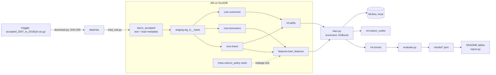
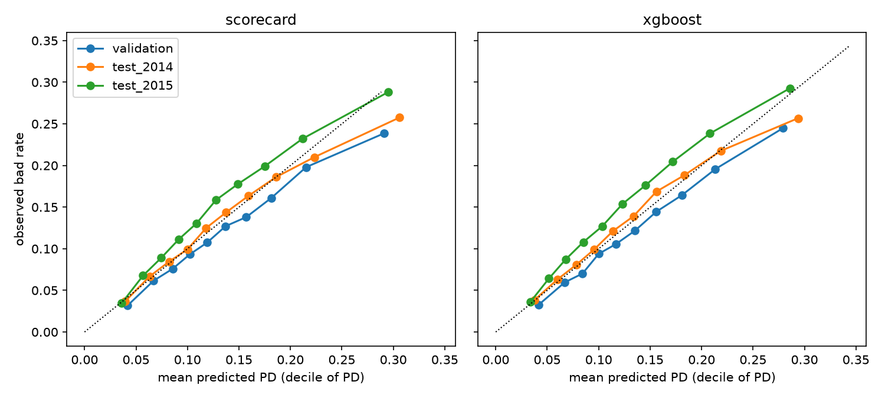
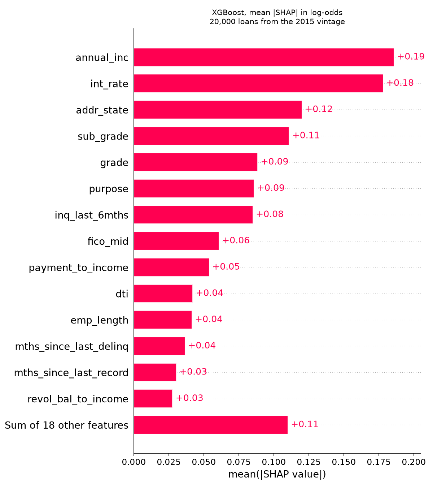

# credit-risk

Consumer credit default models on public data, built on a small but complete data platform. Lending Club accepted loans (2007 to 2018) are loaded into a layered DuckDB warehouse with dbt (raw, staging, core, features, ml) and tested at each layer. Point-in-time features are built in SQL and a test enforces the leakage exclusion list. Two baselines are trained and evaluated out of time by issue year: a weight-of-evidence logistic regression scorecard and XGBoost. Both are tracked in MLflow, and reason codes are derived from scorecard points and SHAP values.

This is a rebuild on public data of the kind of out-of-time credit modeling done in financial-services analytics work. It contains no proprietary code, data or details from any employer.

## Status

- M0 to M3 done: skeleton, ingestion and warehouse, features and splits, baselines.
- M4 to M8 pending (see Roadmap).

## Architecture



## Reproduce

Requires Python 3.12, [uv](https://docs.astral.sh/uv/) and about 3 GB of free disk (measured: data/ 2.0 GB, .venv 0.9 GB). No Kaggle account is needed: Kaggle serves this public dataset without an API token.

```bash
make setup   # create .venv and install dependencies
make all     # data -> build -> train -> evaluate -> report
make test    # pytest (synthetic fixtures; the real data is not needed)
make lint    # ruff
```

Steps behind `make all`:

| Target | Command | Output |
|---|---|---|
| data | `python -m credit_risk.download`, `python -m credit_risk.load_raw` | `data/raw/`, `raw.lc_accepted` |
| build | `dbt build --project-dir dbt --profiles-dir dbt`, `python -m credit_risk.data_quality`, `python -m credit_risk.split_summary` | staging, core, features and ml models with dbt tests; `results/m1_data_quality.json`, `results/m2_splits.json` |
| train | `python -m credit_risk.train` | `ml.scores`, `ml.reason_codes`, MLflow runs in `mlruns/`, `results/m3_training.json`, `results/m3_shap.json` |
| evaluate | `python -m credit_risk.evaluate` | `results/m3_evaluation.json`, `figures/m3_calibration.png` |
| report | `python -m credit_risk.report` | the Results section below |

MLflow UI: `.venv/bin/mlflow ui --backend-store-uri sqlite:///mlruns/mlflow.db`.

## Modeling population and splits

- Label: bad = Charged Off or Default, good = Fully Paid (the "Does not meet the credit policy" variants are mapped the same way). Loans still Current, In Grace or Late have no outcome and are excluded.
- Only 36-month loans issued 2007 to 2015 are used, because those vintages have fully matured by the data snapshot (about March 2019). Later vintages and 60-month loans would mix resolved early defaults with unresolved loans.
- Train on issue years 2007 to 2012, validate (early stopping only) on 2013, test on 2014 and 2015 separately.
- Features: 32 application-time attributes (loan terms, Lending Club grade and rate, self-reported income and employment, credit bureau attributes, and five ratios). All choices are listed in [docs/assumptions.md](docs/assumptions.md).

## Results

<!-- results:start -->
Produced by `python -m credit_risk.evaluate` at commit `cf64e87e62fe` (models from `python -m credit_risk.train`, seed 0), data SHA-256 `55c16f75120f...`. Source: `results/m3_evaluation.json`.

Out-of-time evaluation by issue year. Both models are fitted on 2007 to 2012; XGBoost stops early on 2013. Top-decile lift is the bad rate of the riskiest 10% divided by the vintage bad rate; capture is the share of all bads in the riskiest 30%.

| Model | Vintage | Loans | Bad rate | Mean PD | AUC | KS | Brier | Top-decile lift | Capture, top 30% |
|---|---|---|---|---|---|---|---|---|---|
| scorecard | 2013 (validation) | 100,422 | 0.123 | 0.140 | 0.659 | 0.229 | 0.1049 | 1.94 | 0.485 |
| scorecard | 2014 (test) | 162,570 | 0.137 | 0.141 | 0.659 | 0.234 | 0.1144 | 1.88 | 0.476 |
| scorecard | 2015 (test) | 283,026 | 0.149 | 0.133 | 0.668 | 0.246 | 0.1216 | 1.94 | 0.483 |
| xgboost | 2013 (validation) | 100,422 | 0.123 | 0.137 | 0.664 | 0.240 | 0.1045 | 1.99 | 0.491 |
| xgboost | 2014 (test) | 162,570 | 0.137 | 0.137 | 0.663 | 0.243 | 0.1141 | 1.87 | 0.483 |
| xgboost | 2015 (test) | 283,026 | 0.149 | 0.128 | 0.674 | 0.256 | 0.1214 | 1.97 | 0.494 |

Training set: 75,004 loans, bad rate 0.130 (`results/m2_splits.json`). XGBoost used 119 trees (`results/m3_training.json`). Calibration by PD decile is in `figures/m3_calibration.png`.

XGBoost, top 10 features by mean |SHAP| on 20000 loans from test_2015 (`results/m3_shap.json`):

| Feature | Mean \|SHAP\| (log-odds) |
|---|---|
| annual_inc | 0.186 |
| int_rate | 0.178 |
| addr_state | 0.120 |
| sub_grade | 0.111 |
| grade | 0.088 |
| purpose | 0.086 |
| inq_last_6mths | 0.085 |
| fico_mid | 0.061 |
| payment_to_income | 0.054 |
| dti | 0.042 |

Most frequent first reason code on the 2014 and 2015 test loans (`ml.reason_codes`, summarised in `results/m3_evaluation.json`):

| Model | Feature | Share of loans |
|---|---|---|
| scorecard | addr_state | 0.778 |
| scorecard | sub_grade | 0.183 |
| scorecard | purpose | 0.017 |
| xgboost | annual_inc | 0.215 |
| xgboost | addr_state | 0.171 |
| xgboost | int_rate | 0.086 |
<!-- results:end -->





## Limitations

- Public data from a single lender. Lending Club grade and interest rate are features, so the models partly build on Lending Club's own risk pricing.
- The snapshot ends about March 2019. Using only matured 36-month vintages avoids censoring bias but drops 60-month loans and all vintages after 2015.
- About 30 bureau attributes were introduced around 2012 and are not used, because the training vintages lack them.
- There is no borrower key, so repeat borrowers cannot be linked.
- `addr_state` ranks high in both models and is the most frequent first reason code of the scorecard. Geography can act as a proxy for protected characteristics. A fairness review is planned for M6, and reason codes based on geography would not be acceptable as adverse-action reasons in practice.
- Mean predicted PD trails the observed bad rate in 2015, so the models are not recalibrated for vintage drift. Calibration is M6.
- Hyperparameters are fixed defaults, not tuned.

## Roadmap

- M4: Dagster assets for the pipeline; failing dbt tests stop the run.
- M5: monitoring (PSI per feature and score drift by vintage, performance decay) and Slack alerting.
- M6: alternative models (LightGBM, CatBoost), monotonic constraints, calibration, leakage audit, fairness check, model card.
- M7: Freddie Mac Single-Family Loan-Level Dataset with PySpark in the same layered layout.
- M8: fraud module on IEEE-CIS Fraud Detection.

## Data and license

- Lending Club accepted loans 2007 to 2018Q4, Kaggle dataset [wordsforthewise/lending-club](https://www.kaggle.com/datasets/wordsforthewise/lending-club) by Nathan George, listed on Kaggle as CC0: Public Domain. The data was originally published by LendingClub. File `accepted_2007_to_2018Q4.csv.gz`, SHA-256 `55c16f75120f897683f02e7aabcf080d0e4a20c4832feb1d592cfa941bd62a2d`, downloaded 2026-11-04. The data is not redistributed in this repository.
- Code: MIT, see [LICENSE](LICENSE).
